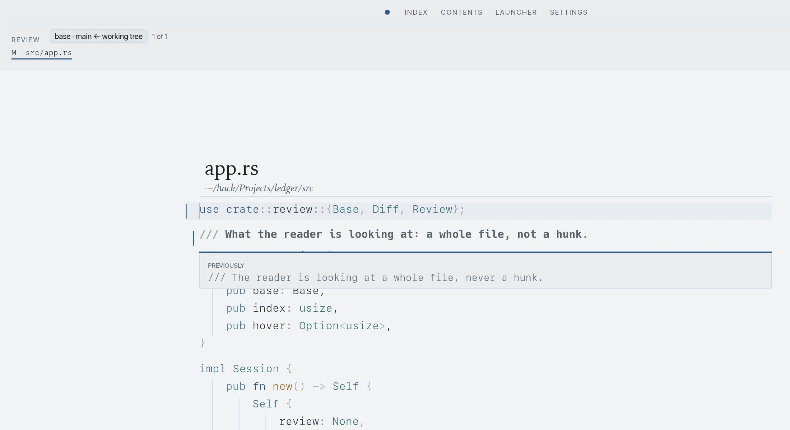

# zenith

> **Experimental, and written by an AI.** An early-stage prototype, not a product:
> expect rough edges, and expect the keybindings, settings and config format to change
> without notice.

**A reading room for source code.**  
<https://dovidio.github.io/zenith/>


Zenith is a native, read-only code reader for code you have to understand but didn't write: a review, an inherited service, a dependency you need to trust. It is not an editor with the editing removed. The page opens alone; the index, contents, launcher and settings are doors you summon.

## Run it

```sh
cargo run --release -- ~/code/some-project
```

Rust 1.92 or newer. macOS and Linux; Windows is written for but untested. Nothing is bundled: fonts and language servers come from the machine.

## Review a branch

Review reads whole files, not hunks. `g r` opens the working tree; `g b` chooses a staged index, last commit, branch or commit. A branch is compared from its common ancestor with `HEAD`, the way a pull request is.

Changed lines carry more weight, and the code they replaced lifts in place when you hover it or press `p`. Untracked source is included; ignored and dependency trees never are. `J K` moves through changed files, `[ ]` through changes, and `q` keeps the review through a definition detour.



## Reading

Vim motions as far as a reader needs them: `j k`, `w b e`, `gg G`, `%`, `gd` to a definition, `ctrl-o` back. Code is set in mono, comments in serif, chrome in a humanist sans. Six complete themes, rendered Markdown, a focus lens and distilled reading. Nothing is written into the project.

## Read more

- [The site](https://dovidio.github.io/zenith/) — the full tour and the six themes.
- [DESIGN.md](DESIGN.md) — the design system.
- [AGENTS.md](AGENTS.md) — architecture, keys, language servers and development checks.
- [MIT licence](LICENSE-MIT).
