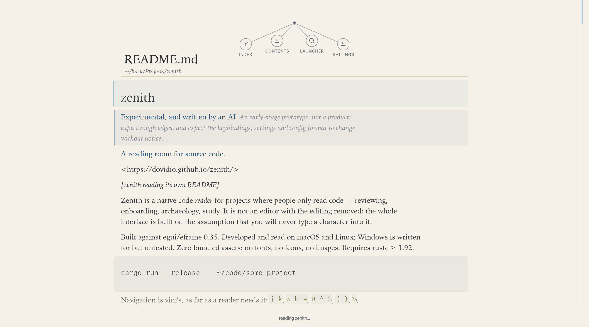
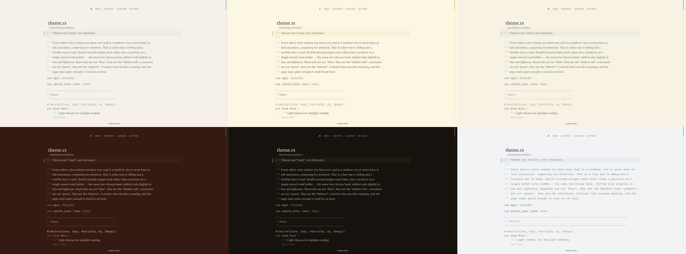

# zenith

> **Experimental, and written by an AI.** An early-stage prototype, not a product:
> expect rough edges, and expect the keybindings, settings and config format to change
> without notice.

**A reading room for source code.**



Zenith is a native code *reader* for projects where people only read code — reviewing,
onboarding, archaeology, study. It is not an editor with the editing removed: the whole
interface is built on the assumption that you will never type a character into it.

Built against egui/eframe 0.35. Developed and read on macOS and Linux; Windows is written
for but untested. Zero bundled assets: no fonts, no icons, no images. Requires rustc ≥ 1.92.

```sh
cargo run --release -- ~/code/some-project
```

Navigation is vim's, as far as a reader needs it: `j k`, `w b e`, `0 ^ $`, `{ }`, `%`,
`gg G`, `H M L`, `zz zt zb`, `ctrl-d ctrl-u`, `[ ]` for chapters, and `ctrl-o` / `ctrl-i`
to go back and forward through everywhere you have been. The folder tree takes the
keyboard too: `tab` to enter it, `j k` to move, `l` or `enter` to open a file or fold a
folder, `h` to back out, `esc` to return to the page. Two finders, deliberately separate:
`⌘P` (or `ctrl-p`) finds *a file*, `/` (or `⌘F`) searches *inside the file* you are
reading. Press `?` in the app for the whole map.

---

## Why it does not look like your editor

An editor optimises for *changing* text: a caret, a gutter of line numbers, a rainbow of
token colours so you can spot mistakes, horizontal scrolling, a status bar full of build
state. A reader optimises for *understanding* text. Zenith makes five bets.

- **Indentation is not whitespace.** Leading whitespace is stripped out of the text and
  drawn as *whisper hairlines* in a gutter — one per nesting level, fading with depth. You
  feel the shape of a block instead of counting spaces.
- **Comments are prose.** They are the only part of a source file written in English, so
  they are the only part set in a reading face: a serif, italic, in the faintest ink. The
  `//` or `#` mark is left behind in faint monospace, like a printer's pilcrow.
- **Blank lines are compressed.** A blank line costs 46% of a line, so a file's paragraph
  rhythm survives without the page turning into a corridor.
- **Long lines wrap and declare themselves.** Every row that continues a wrapped line is
  marked with `↳` in the margin, so you are never lost mid-expression, and you never scroll
  sideways. The reading measure is a setting, not an accident of window size.
- **Attention is a gradient.** The *focus lens* (`f`) dims everything except the block you
  are reading — painted as a scrim over the paper, so it looks like the page coming forward
  rather than a change of colour in the text.

### Tones, not rainbow

Every editor colour scheme is a rainbow: six or seven hues at full saturation, competing
for attention. Terrible for reading. Zenith assigns each token class a position on a
single muted tonal ladder — the same low-chroma band, shifted only in hue and lightness.

| tone | what it means | how it reads |
|---|---|---|
| `Keyword` | `fn`, `struct`, `class`, `if` | the darkest ink on the page |
| `KeywordSoft` | `pub`, `async`, `unsafe`, lifetimes | the same word, spoken quietly |
| `Type` | `String`, `HashMap`, `str`, `u32` | slightly cool |
| `Call` | function and method names | slightly warm |
| `Constant` / `Number` / `Str` | literals | three neighbouring tones |
| `Meta` | `#[derive]`, `@decorator`, `println!` | amber, like a margin note |
| `Comment` / `Doc` | prose | the faintest ink, in the serif |
| `Operator` / `Punct` | `=`, `->`, brackets | nearly a whisper |

Casing is a signal too: a capitalised word the grammar left unclassified is a type, not an
identifier. That single heuristic is what lets you read an unfamiliar codebase and see
shapes instead of soup.

### Three voices

A code editor is set in one monospace face, everywhere, forever. Zenith sets **code** in a
monospace voice (SF Mono by default; Hack, Menlo, Monaco, PT Mono…), **prose** — comments,
titles, the colophon — in a serif (Iowan Old Style; Charter, Athelas, Palatino,
Baskerville, Georgia…), and **chrome** in a humanist sans (SF Pro; Helvetica Neue, Avenir
Next, Optima, Geneva…).

Nothing is bundled: it reads the typefaces already on the machine and measures the glyphs
source code depends on before trusting them. That check earns its keep — Apple's handsome
New York maps `_` in its character table and draws it 0.005 em thick, so `snake_case_name`
renders as `snake case name`, and the default prose voice is Iowan Old Style because of it.
`zenith --fonts` says why any face was refused.

### Markdown, rendered

A Markdown file is rendered as the document it describes rather than set as its source:
`## Notes` is a heading called *Notes*, larger and in the strongest ink; `**strong**` is
stronger; emphasis is the italic face; `` `code` `` is the monospace voice on a tint of the
paper. Quotations are italic on a band with a rule down their left edge, fenced blocks sit
on that band with their contents untouched — a `#` in a code block is not a heading — and
`---` is a hairline rather than three dashes. `_` between word characters is not emphasis,
so a document that mentions `snake_case_name` keeps its underscores. Tables are shown as
paragraphs rather than grids, and `x` toggles back to the source, because sometimes the
source is what you came to read.

### Distilled reading

`d` recedes what a human is not reading in a strongly typed language: the type annotation,
the modifiers, the punctuation only a compiler needs. It changes **ink, not geometry** — no
token is removed, so lines wrap exactly as the file does and nothing is silently hidden
from a search or a motion.

| shape | languages | example | what recedes |
|---|---|---|---|
| annotation after the name | Rust, TypeScript, Python, Kotlin | `let total: Vec<u8> = …` | from the `:` to the `=` |
| type before the name | Java, C#, C, C++, Dart | `Map<String, Object> m = …` | the type, including generics |
| type after `var`, or a field | Go | `var x int = 1`, `Name string` | the type, not the name |

The rule that matters most is the one that *refuses*: a colon also introduces a dictionary
entry, a struct-literal field, a slice bound and a ternary's else, and fading a **value** is
far worse than fading nothing, because the reader cannot tell that something is missing. So
a `:` inside brackets is left alone, a run containing a literal or a call is left alone, and
an `=`-less colon must positively look like a type (`balance: i64,` recedes, `balance:
total,` does not).

### Six themes

Each is a tonal ladder plus a page, named for something it actually resembles — a theme is
a place, not a colour swatch:

| theme | the thing | what carries it |
|---|---|---|
| **Lugano** | the lake at midday | pale stone paper, lake-blue keywords, cypress types, terracotta calls |
| **Maionese** | a jar of the stuff | butter paper, dark olive ink, yolk-gold accents, gherkin green |
| **Bibione** | sand, pine shade, the Adriatic | warm sand paper, deep-sea keywords, pine types, umbrella orange |
| **Kununurra** | pindan red earth and the Ord | red-brown ground, turquoise keywords, sand ochre types, spinifex green |
| **Panittha** | temple gold, jade, teak | dark teak ground, gold-leaf keywords, jade types, lotus-pink numbers |
| **Newsprint** | cold type, cheap stock | cool grey, no warmth in it at all |

`1`–`6` pick one; the settings panel names them.



---

## The team shelf

Zenith is built for reading *a team's* work, so it opens onto a catalogue rather than a
file dialog:

- **Team** — every project under your workspace root (the first of `~/hack`, `~/projects`,
  `~/code`, `~/dev`, `~/src`, `~/work` that exists), found from repository and manifest
  markers and ordered by most recently touched — a team's attention is usually the thing
  worth following.
- **Shelves** — any folder you name by hand in the config.
- **Open a folder…** (`⌘O`, or drag a folder onto the window) for anything else.

Inside a project the tree respects the repository's own `.gitignore`, skips build output
and dependency trees outright, and floats the doorways — README, manifests, entry points —
to the top of each folder. Opening a project puts you in front of its README, not the first
file alphabetically.

## It does not change your code

Zenith reads your project and writes nothing into it. Files are opened with
`std::fs::read`; there is no save, no lockfile, and no cache directory inside the
repository. Its own state — theme, typography, measure, reading positions, bookmarks —
lives in `~/.config/zenith/`, and if that directory is not writable it degrades to an
in-memory session rather than failing. That is a property of the code, not a promise in a
README: read for a while, then diff the modification times of a copy and nothing will have
moved.

## Notes

- **Platforms.** Nothing is hard-coded to one. Zenith scans the font directories of the
  machine it is running on — macOS, Linux (`/usr/share/fonts`, `~/.local/share/fonts`,
  `~/.fonts`, …), Windows — and if nothing matches, a bare container or an unusual
  distribution, it says so once and sets the page in egui's bundled faces rather than
  failing to start. On Linux, `rfd` uses the XDG desktop portal for "open a folder", so a
  portal needs to be present for that one dialog; everything else works without it.
- **The window's own bar.** On macOS the window stays entirely the system's — frame,
  traffic lights, dragging, resizing, snapping — with only the title bar made transparent,
  so the theme shows through it. On Linux and Windows a window manager paints its own frame
  and cannot be asked for a colour, so zenith draws one, buttons included, and `⌘Q`/`Ctrl+Q`
  quits everywhere regardless.
- **Diagnostics.** There is a headless mode for almost everything: `--dump`, `--scopes`,
  `--md`, `--distill`, `--fonts`, `--faces`, `--glyphs` (which mark the fonts here can
  actually draw), `--walk` (what a folder cost), and `--smoke` (renders the app to a PNG,
  which is how the screenshots above were taken).
- **How it was written.** The code, the tests, this README and the screenshots were
  produced by an AI agent working from a human's direction. No human has read every line —
  treat it as a prototype, and read the code before you trust it with something you care
  about.

## Licence

Released under the [MIT licence](LICENSE-MIT).
